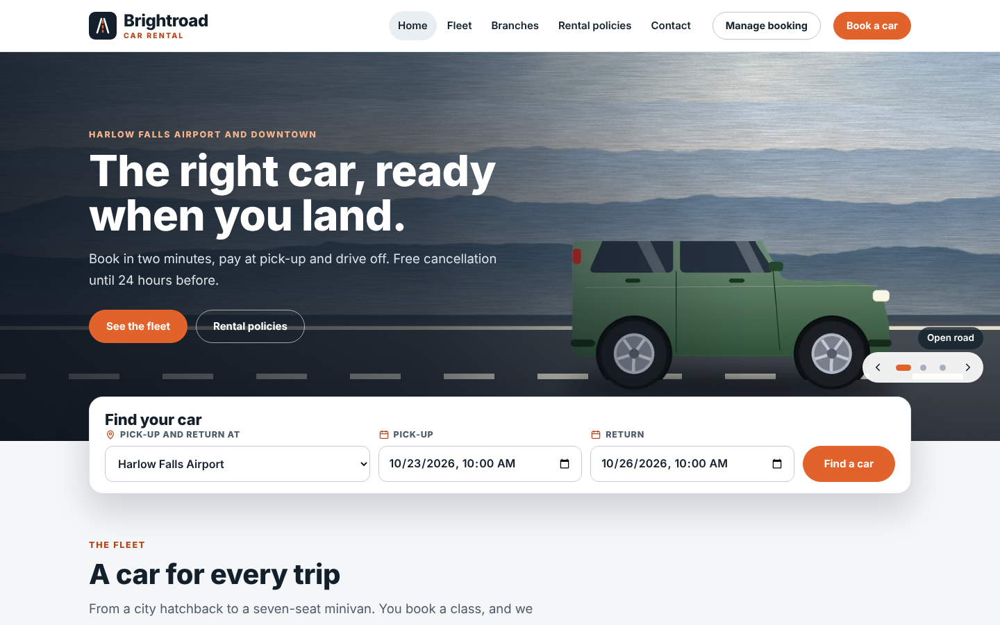

# Brightroad Car Rental — SkyNet Car Rental Template

A car rental website with a full rental desk for **ASP.NET Core (.NET 10)**, built on the **SkyNet Framework**.

> **Sample content.** Brightroad, its city (Harlow Falls), branches, car makes and models, staff, customers and phone numbers are invented placeholders; replace them in the staff area. Every form already saves for real: bookings, check-outs, check-ins, extensions, transfers and messages are written to the JSON files in `data/`, and customer emails are sent once you fill in the `app.mail.*` settings.

## Features

- **33 pages:** 9 public (Home, Fleet, Vehicle class, Search results, Book, Manage booking, Branches, Rental policies, Contact) and 24 staff (sign-in, Dashboard, Desk, Bookings, Calendar, Fleet, Maintenance, Repairs, Incidents, Transfers, Car sales, Branches, Classes and rates, Extras, Payments, Insurers, Reports, Pages, Media library, Messages, Staff, Settings, Activity log, My account)
- **Real availability:** every booking holds a specific car of its class at its branch, with a cleaning time between rentals. If a class looks full, the site first tries to move one future booking to another free car of the same class
- **Online booking:** search by branch and dates, see the full rental price per class, add child seats, GPS, extra drivers and coverage, enter the driver (age checked at pick-up) and get a booking code. Pay at pick-up
- **Manage booking:** with the code and email, customers see their booking, cancel it free until 24 hours before pick-up, or ask for a later return
- **Desk:** today's pick-ups, returns, cars on rent and extension requests per branch. Check-out records the car, mileage, fuel (in eighths), the condition of 8 panels, notes and up to 8 photos. Check-in shows the check-out side by side and works out fuel, extra miles, late days, cleaning and damage charges
- **Extensions:** keeps the same car when it is free, moves the next booking to another car when it is not, or says no. The new price is shown before staff confirm, and the change is logged
- **Car statuses:** Available, Reserved, On rent, Cleaning, Maintenance, Repair, In transfer, Hold, Stolen, Sold, with the flags Overdue, Service due, Registration due and Open incident. Statuses change through actions; by hand staff can only put a car on hold or mark it ready, with a reason
- **Calendar:** free cars per class and day at a branch, every car of a class across the month, or one car's month
- **Transfers:** planned, in transit and arrived, with bookings moved off the car before it leaves
- **Maintenance:** plan services with a time window that blocks the booking calendar, a cars-due-soon list from mileage and registration dates, start and finish with mileage and cost; the next service is set automatically
- **Repairs:** opened by hand or automatically at a damaged check-in, with shop, estimate, ready-by time and final cost; with a ready-by time the car can be booked again from then
- **Incidents:** theft, accident, vandalism, breakdown, tickets and lost keys with the police report, photos and the booking at that time. A stolen car leaves the fleet, its rental ends and its bookings move; when recovered it goes to Repairs for a check
- **Car sales:** sell a car out of the fleet, with buyer, price and gain or loss against the purchase cost; undo a sale if needed
- **Who pays:** the customer, or an insurer for replacement rentals. The insurer pays the rental up to its daily limit (and the extras when agreed); the customer pays the rest. Every booking shows both shares, what each has paid and what each still owes
- **Payments:** desk payments at check-out and check-in, insurer bank transfers, refunds, with filters and totals. An insurer's statement lists its rentals and what it owes, prints, and takes one payment that pays the oldest rentals first
- **Reports:** for any period and branch: revenue by branch, class and car, time on rent, service and repair costs per car, return charges, payments by method, open balances and the rentals returned, each downloadable as a spreadsheet file
- **Permission panel:** no fixed roles. Each person gets View, Add, Edit and Delete per area and the branches they work at; save common combinations as permission sets
- **Pages editor and media library:** click-to-edit pages with versions, one library for every picture
- **Responsive:** desktop, tablet and phone layouts; staff lists become cards on phones
- **No front-end build:** plain HTML, CSS and vanilla JavaScript

## Getting started

Requirements: .NET 10 SDK.

    git clone <repo url>
    cd CarRental
    dotnet run

The SkyNet package (`TheSkyLite.SkyNet`) restores from NuGet. The app opens on **Home**; the staff area is at **/AdminLogin** (every public page has a "Staff sign in" link in the footer).

## Staff area

Each menu item is one area. A person only sees the areas they can view, and only the bookings, cars and transfers of their branches.

| Page | What it does |
|---|---|
| Dashboard | today's pick-ups and returns, overdue cars, extension requests, bookings that need a car, fleet by branch |
| Desk | check-out, check-in, no-show, extensions and requests for one branch and day |
| Bookings | every booking with search, filters and paging; driver, charges, inspections and extensions side by side; new, change, cancel |
| Calendar | free cars per class and day, every car of a class, one car's month |
| Fleet | cars with status, flags, mileage, next booking and history; hold and ready with a reason |
| Maintenance | planned, in progress and done services; cars due soon |
| Repairs | open, in shop and done repairs with costs |
| Incidents | thefts, accidents and tickets with police reports and photos; recovery |
| Transfers | plan a move between branches, mark it left or arrived, cancel |
| Car sales | sell a car, sales this year against purchase cost, undo |
| Payments | every payment and refund with totals; record one for any booking |
| Insurers | insurers with their daily limit and terms; statement, print, record a payment |
| Reports | revenue, utilization, costs, charges, payments and balances for a period |
| Branches | add, edit, close or reopen |
| Classes and rates | daily, weekend day, weekly rate and deposit per class; order on the website |
| Extras | items with stock per branch, services and coverage options |
| Pages, Media library | the public pages and every picture |
| Messages | Contact page messages: New, Read, Replied, Archived |
| Staff | people, rights per area, branches, permission sets, temporary passwords |
| Settings | company facts, booking rules, return charges and the service interval |
| Activity log | every change and every refused request |
| My account | name, rights, branches and password |

## Run mode

`appConfig/application.cfg` has `app.app.runmode`:

- **0 Demo** (as shipped): any password signs in for any active user name, including staff you add. The six sample accounts are `owner` (manager, all branches), `airport` and `downtown` (rental agents), `tech` (fleet technician), `accounts` (accountant: payments, insurers and reports) and `editor` (website editor). Sample dates move forward each day, so the demo always has pick-ups today. Passwords cannot be changed in Demo.
- **1 Production:** staff sign in with their own accounts. Set this before you go live.

## Sample data

Two branches, 7 classes, 37 cars in every status, 6 extras, 44 bookings in every status, 39 inspections, an extension, transfers, 7 services, 3 repairs, 3 incidents (one stolen car), a car sale, 3 insurers paying 5 bookings, 31 payments, 4 messages, 6 staff and 5 permission sets, with 17 pictures in the Media library. **Initialize data** (Settings, managers only, Demo only) removes the bookings, inspections, extensions, transfers, cars, services, repairs, incidents, sales, payments, messages and activity log; branches, classes, extras, pages, settings, staff and media stay.

## Going live

1. Set `app.app.runmode | 1` in `appConfig/application.cfg`.
2. Start the site and open **/AdminLogin**. On this first start in Production the site removes every record made in Demo (bookings, inspections, extensions, transfers, cars, services, repairs, incidents, sales, payments, insurers, messages, the activity log, the sample staff and any sessions), keeps branches, classes, extras, pages, settings, permission sets and media, writes `data/initialized.txt`, and creates the manager account with a new first password. This happens once.
3. Follow **First sign-in** below, then add your cars on **Fleet** and your people on **Staff**.

## First sign-in (Production)

1. Run the site on your computer and open **/AdminLogin**. The page shows the first user name (`admin`) and a password made just for this site. It is shown only on the computer the site runs on, and is also in `appConfig/initial-admin.txt`.
2. Sign in and choose your own password (at least 8 characters).

New staff get a temporary password from **Staff** and choose their own at the first sign-in. A manager can reset anyone's password there. Sign-in pauses for a few minutes after 6 wrong passwords for the same user name.

## Email

Bookings, cancellations and extension answers are emailed to customers, and new bookings, messages and requests can be copied to the address in **Settings**, once you fill in `app.mail.server`, `app.mail.port`, `app.mail.addr`, `app.mail.id` and `app.mail.password` in `appConfig/application.cfg`. With the placeholder values nothing is sent; everything is still saved.

## Data

Each record type is one JSON file in `data/` shaped like a table (`branches`, `classes`, `cars`, `extras`, `bookings`, `inspections`, `extensions`, `transfers`, `services`, `repairs`, `incidents`, `sales`, `insurers`, `payments`, `messages`, `staff`, `permsets`, `media`, `site`), so it can move to a database later through `codes/Core/Store.cs`.
 